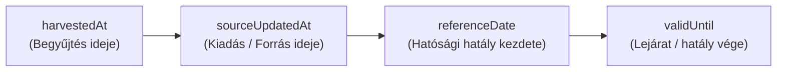

# Közös Tervezési Dokumentum és Forrásspecifikáció: Meteoalarm, Vízügyi és Nébih Integráció

**Dokumentum azonosító:** `CRUCIX-INTEGRATION-PLAN-2026-V3`  
**Dátum:** 2026-10-23  
**Státusz:** Felülvizsgált tervezési és specifikációs dokumentum.  
**Kötöttségek:** Kizárólag tervezési dokumentum. Alkalmazáskódot, adapter-implementációt, külső függőséget, éles értesítést, hálózati ütemezést vagy deployt önmagában nem tartalmaz és nem engedélyez.

---

## 1. Vezetői Összefoglaló és Tervezési Alapelvek

A Crucix rendszer Bihartorda térségi és hazai veszélyhelyzeti tájékoztatási képességének bővítésére három forrástartomány került felmérésre:
1. **Meteorológia (Meteoalarm CAP v1.2):** Helyi adapter és unit tesztcsomag kész, lezárt commit: `5d70251bd129ea960b0edd1364e2264f33c40579`.
2. **Vízügy (OVF ArcGIS REST & TIVIZIG közlemények):** Végpontok és rétegek felmérve; a bizonyítéki hiányok, idődekódolások és TLS-feltételek tisztázva.
3. **Nébih Települési Táblázatok (ASP, méhbetegség, madárinfluenza):** Táblázatszerkezetek, adatszótárak, stabil kulcsképzés és hibakezelés specifikálva.

### Szigorú Tervezési Szabályok:
- **Tényalapú adatkezelés:** Készültségmentességet kizárólag olyan hivatalos adat alapján állítunk, amely kifejezetten ezt közli, azonosított területtel és vonatkozási idővel. Az üres RSS/táblázat nem jelent igazolt veszélymentességet.
- **Dátum-integritás:** Tilos záródátumokat vagy feloldásokat kikövetkeztetni. Az üres záró cella határozatlan idejű intézkedést jelent, nem aktív zárlatot vagy lezárást. A `0` érték megjegyzéskód, nem dátum.
- **Stabil rekordazonosítás:** Az azonosító kizárólag a hatósági intézkedést egyedileg definiáló stabil adatokból állhat (`betegség + megye + település + kezdő dátum`). A záró dátum és a megjegyzés változó attribútum.
- **Forrásszintű drift-védelem:** A madárinfluenza és más források szerkezeti változása (`schema drift`) izoláltan tiltja le az adott forrást a legutóbbi állapot megőrzése mellett; nem állítja le a teljes adatgyűjtési folyamatot.
- **Biztonságos hálózati kapcsolat:** Nyilvános CA által hitelesített TLS kötelező. Önaláírt vagy hibás tanúsítványú hosztok (`tivizig.hu`) tiltottak; tanúsítvány-ellenőrzés kikapcsolása (`rejectUnauthorized: false`) tilos.

---

## 2. Közös Forrás- és Adatútmátrix

| Forrástartomány | Konkrét Forrás és Végpont | Adatformátum és Hozzáférés | Képviselt Névtér és Jelenség | Frissülési Ciklus | Hozzáférési és Használati Státusz |
| :--- | :--- | :--- | :--- | :--- | :--- |
| **Meteorológia** | Meteoalarm CAP v1.2 (`meteoalarm.org` atom feed) | Nyilvános XML / CAP v1.2 | `weather.meteoalarm` (Szél, ónos eső, zivatar stb.) | ~5–15 perc | **Működő, tesztelt adatút** (EUMETNET nyílt licenc) |
| **Vízügy – Aszály** | OVF Operatív Aszálymonitoring (`ovfgis2.vizugy.hu`, MapServer 0) | ArcGIS REST (`f=pjson`), nyílt hozzáférés | `water.drought_monitoring` (Talajnedvesség, HDI index) | Névleg napi modell (utolsó: 2026.10.16) | **Szemantikailag korlátozott** (aggregáció nem dokumentált) |
| **Vízügy – Vízhiány** | OVF VIR Vízhiány Körzetek (`geoportal.vizugy.hu`, MapServer 0) | ArcGIS REST (`f=pjson`), nyílt hozzáférés | `water.scarcity_defense` (Vízhiány elleni védekezés) | Eseményvezérelt (utolsó: 2026.10.17) | **Vizsgált adatút**, kódolt domén hiányzik |
| **Vízügy – Belvíz** | OVF VIR Belvízvédelmi Szakaszok (`geoportal.vizugy.hu`, MapServer 12) | ArcGIS REST (`f=pjson`), nyílt hozzáférés | `water.excess_water` (Belvízvédelmi készültség) | Eseményvezérelt (rekord: 2000-01-01) | **Szemantikailag nem igazolt** (`"-"` fokozat kódolatlan) |
| **Vízügy – Közlemények** | TIVIZIG Hírek (`https://www.tivizig.hu/tiszantuli/...`) | HTTPS RSS és HTML cikkek | `water.announcements` (Helyi vízkorlátozások) | Eseti publikáció | **Biztonságos átírással vizsgált** (érvényes Microsec TLS) |
| **Nébih – ASP** | `portal.nebih.gov.hu/asp_telepulesek` | Nyilvános HTML táblázat | `epidemic.asf_settlement` (Afrikai sertéspestis körzetek) | Időszaki (fejléc: 2026.10.12) | **Jóváhagyott 1. csomag**, robotika és közadat-újrahasznosítás ellenőrizve |
| **Nébih – Méhbetegség** | `portal.nebih.gov.hu/mehbetegseg-zarlatok` | Nyilvános HTML táblázat | `epidemic.bee_quarantine` (Nyúlós költésrothadás zárlatok) | Időszaki (utolsó: 2026.10.20) | **Külön csomagba sorolva**, jelen csomagból kizárva |
| **Nébih – Madárinfluenza** | `portal.nebih.gov.hu/madarinfluenza-telepulesek` | Nyilvános HTML szöveges közlés | `epidemic.avian_flu` (Madárinfluenza korlátozások) | Időszaki (`2026.07.24`) | **Külön csomagba sorolva**, jelen csomagból kizárva |
| **Nébih – Térképportál** | `terkepportal.nebih.gov.hu` (MapServer) | Esri Web App / belső proxy | GIS vektoros rétegek | Interaktív térkép | **Közvetlen gépi hozzáférésre alkalmatlan** (Token 499) |

---

## 3. Egységes Időkezelési Architektúra

Az időbélyegek összekeverésének elkerülésére minden normalizált esemény kötelezően négy különálló időmezőt tartalmaz:



1. **`harvestedAt` (ISO 8601 UTC):**  
   A hálózati lekérdezés pontos ideje a Crucix szerveren (pl. `2026-10-23T07:50:42Z`).
2. **`sourceUpdatedAt` (ISO 8601 UTC / null):**  
   A forrás által expliciten közölt utolsó módosítási / publikálási időpont:
   - Meteoalarm: `<sent>` időbélyeg (pl. `2026-10-23T06:15:00Z`).
   - OVF VIR: `UtolsoFrissitesIdopont` (pl. `1760690655000` -> `2026-10-17T08:44:15Z`).
   - Nébih ASP: táblázat fejlécében közölt módosítási dátum (pl. `2026.10.12`).
   - Nébih Madárinfluenza: szöveges közlésben lévő dátum (`2026.07.24` -> `2026-07-24T00:00:00Z`).
   - Ha a forrásban nincs megadva: szigorúan `null`.
3. **`referenceDate` (ISO 8601 UTC / Dátum):**  
   A hatósági intézkedés, készültség elrendelésének vagy a modellfutás szakmai kezdő időpontja:
   - OVF VIR Vízhiány: `Idopont` mező (pl. `1753783200000` -> `2026-07-29T10:00:00Z`).
   - Nébih ASP: táblázat fejlécében rögzített közzétételi / hatályossági nap (`2026-10-12`).
   - Nébih Méhbetegség: táblázat `Kezdő dátum` oszlopa (`2026-04-15`).
4. **`validUntil` (ISO 8601 UTC / null):**  
   A dokumentált hivatalos lejárat vagy hatályvesztés időpontja:
   - Meteoalarm: `<expires>` időbélyeg.
   - Nébih Méhbetegség: táblázat `Záró dátum` oszlopa, **ha kitöltött, érvényes dátum**.
   - **Ha nincs dokumentált lejárat (üres záró cella, VIR készültség, ASP táblázat): kötelezően `null`!**  
     Fiktív vagy mesterséges lejárat generálása szigorúan tilos.

---

## 4. Területi Illesztési Szintek és Sémamezők

A térinformatikai pont-poligon vizsgálat és a közigazgatási hatósági besorolás élesen elkülönül.

### Belső Sémareprezentáció:
```json
{
  "territorialMatching": {
    "settlementId": "bihartorda",
    "kshSettlementCode": "29887",
    "point_in_polygon": true,
    "distance_to_boundary_m": 1859.2,
    "geodetic_method": "WGS84_Vincenty_inverse",
    "settlement_overlap_ratio": null,
    "official_settlement_assignment": "Fertőzött terület (SZKT-n kívüli része)",
    "official_assignment_percentage": 100,
    "source_layer_version": "2026-10-17T08:44:15Z",
    "query_time": "2026-10-23T07:50:42Z",
    "boundary_status": "unverified",
    "matching_certainty": "exact_name_and_county_match"
  }
}
```

### Meződefiníciók és Integritási Szabályok:
- **`point_in_polygon` (Boolean):**  
  `true`, ha a település megadott referenciapontja a térinformatikai zónán belül található.  
  *Kritikus szabály:* A pontérintettségből tilos a település teljes közigazgatási területére következtetni.
- **`settlement_overlap_ratio` (Float, 0.0–1.0 / null):**  
  A település teljes közigazgatási területe és a vízügyi/járványügyi zóna közötti területi metszet aránya.  
  *Dokumentált hiány:* Hitelesített, gépi feldolgozásra licencelt közigazgatási határpoligon hiányában értéke kötelezően **`null`**.
- **`official_settlement_assignment` (String / null):**  
  Közigazgatási név szerinti hatósági megnevezés (pl. Nébih ASP táblázat: *"Fertőzött terület"*). Csak akkor tölthető ki, ha a forrás név szerint tartalmazza a települést.
- **`official_assignment_percentage` (Integer / null):**  
  A táblázatban szereplő lefedettségi arány (pl. ASP táblázatban `100%`).
- **`ambiguous_identity` kezelési szabály:**  
  Ha a településnév + vármegye párosítás alapján több KSH-azonosító illeszkedne (homonimák, közigazgatási összevonások) vagy a gazetteerben nem azonosítható egyértelműen:  
  - Tilos véletlenszerű vagy feltételezett KSH-kódot hozzárendelni (`kshSettlementCode: null`).  
  - A státusz: **`ambiguous_identity`** vagy **`unresolved_identity`**.  
  - Az esemény megjelölése: `dataQualityFlag: 'ambiguous_identity_requires_review'`.  
  - Tilos az ilyen rekordból automatikus értesítést kiküldeni.

---

## 5. Vízügyi Elemzési Eredmények és Módszertan

### A) Geodéziai Határtávolság-Számítás (WGS84 Vincenty-módszer)
A korábbi Web Mercator vetületi torzítás helyett a távolságokat a WGS84 ellipszoidon, inverz Vincenty-formulával számítottuk újra:
- **Pont 1 (Törzsadat, `territory.mjs`):** `lat: 47.1658, lon: 21.3650` (Községháza referenciapont).
- **Pont 2 (Keresési pont):** `lat: 47.1611, lon: 21.3789` (GIS centroid közelítés).
- **Terepi geodéziai távolság Pont 1 és Pont 2 között:** **1176,37 méter**.

| Forrásréteg és Végpont | Körzet / Szakasz | Pont 1 (Törzsadat) Geodéziai Távolság | Pont 2 (Keresőpont) Geodéziai Távolság | Illesztési Minősítés |
| :--- | :--- | :--- | :--- | :--- |
| **Operatív Aszálymonitoring** (`ovfgis2.vizugy.hu`, MapServer 0) | `OBJECTID: 62`, `09.02. TÖR` | **1859,4 m** (zónán belül) | **860,2 m** (zónán belül) | **Ellenőrizendő** (pontérintettség) |
| **VIR Vízhiány Körzetek** (`geoportal.vizugy.hu`, MapServer 0) | `OBJECTID: 84`, `09.02. TÖR` | **1859,2 m** (zónán belül) | **860,0 m** (zónán belül) | **Ellenőrizendő** (pontérintettség) |
| **VIR Belvízvédelmi Szakaszok** (`geoportal.vizugy.hu`, MapServer 12) | `OBJECTID: 39`, `09.07. Hamvas–Sárréti` | **1897,5 m** (zónán belül) | **899,2 m** (zónán belül) | **Ellenőrizendő** (pontérintettség) |

### B) Településterület (21,88 km²) és KSH Helységnévtár Státusza
- A Bihartordára korábban hivatkozott `21,88 km²` érték, valamint a KSH Helységnévtár (HNT) területoszlopának hivatalos dokumentált módszertana:
- **Rögzített státusz:** **NEM ELLENŐRZÖTT (unverified)** mind a számérték, mind a pontos oszlopdefiníció tekintetében, mivel a KSH HNT webes felülete automatizált lekéréssel nem volt reprodukálható (`Request Rejected`).

### C) TLS Tanúsítványok, Verifikált Válasz és Üzemeltetési Kockázat
A TIVIZIG szervereinek különálló TLS vizsgálata:

1. **`tivizig.hu` (www nélkül):**
   - **Eredmény:** `SSLCertVerificationError: self-signed certificate` (Verify error: 18).
   - **Státusz:** **TLS-hiba miatt blokkolt, közvetlen lekérésre szigorúan tilos használni.**
2. **`www.tivizig.hu` (www előtaggal):**
   - **Eredmény:** **SIKERES Rendszer-CA ellenőrzés (HTTP 200, TLS Verified)**.
   - **Kibocsátó (Issuer):** `Microsec Ltd.` / `e-Szigno OV TLS CA 2026` (VATHU-23584497).
   - **Alany (Subject):** `commonName: www.tivizig.hu`, `organizationName: Tiszántúli Vízügyi Igazgatóság`.
   - **Lejárat (Not After):** `2027. január 17. 09:47:05 GMT`.
   - **Válasz mérete:** 266 677 bájt.
   - **Újraszámított verifikált tartalomhash (SHA-256):**  
     `cb48bd59c2eb7bd0f9b305769037996ce1cedfc4abcfd610731bca4bb9df8b06`.
3. **Üzemeltetési kockázat:**  
   > [!WARNING]
   > A `www.tivizig.hu` tanúsítványa 2027. január 17-én lejár. A tanúsítvány érvényességének automatizált felügyelete és lejárati riasztása üzemeltetési kötelezettség.
4. **Biztonsági átírási szabály:**
   - Eredeti RSS hivatkozás: `http://localhost:8080/tiszantuli/hirek/ovf-hirek/tajekoztatas`
   - Normalizált URL: `https://www.tivizig.hu/tiszantuli/hirek/ovf-hirek/tajekoztatas`
   - A tanúsítványellenőrzés kikapcsolása szigorúan tilos.

### D) Vízügyi Kódtáblák és Belvíz Szemantika
- **`FokozatKod 720` és `724`:** A MapServer réteg metaadataiban a kódolt domén hiányzik (`domain: None`). Hivatalos kódtábla nélkül numerikus jelentésük **nem igazolt**. Kizárólag a literális szöveg (`Fokozat: "Rendk!"`) fogadható el adatként.
- **Belvíz Layer 12 `Fokozat: "-"` és `Idopont: 946684800000` (2000-01-01):**  
  A kötőjel nem dokumentált, kódolt domén nincs. **Nem jelent igazolt készültségmentességet.** Státusz: **jelentés és vonatkozási idő nem igazolt**.
- **Renderer értelmezés:** A `drawingInfo.renderer` kizárólag megjelenítési stílusként kezelhető, nem jogi vagy szakmai kódmagyarázatként.

---

## 6. Nébih Települési Táblázatok Részletes Specifikációja

### A) Javított Stabil Rekordazonosító Stratégia
A záró dátum és a megjegyzés **nem** része a kulcsnak.

#### 1. Stabil Kulcs Definíciója:
```
stableKey = SOURCE_PREFIX + "|" + normalize(disease) + "|" + normalize(county) + "|" + normalize(settlement) + "|" + normalize(startDate)
```
- ASP minta: `ASP|afrikai_sertes_pestis|hajdu_bihar|bihartorda|2026_10_12`
- Méhbetegség minta: `BEE|nyulos_koltesrothadas|hajdu_bihar|gaborjan|2026_04_15`

#### 2. Ütközéskezelés Azonos Stabil Kulcsú Soroknál:
Ha a hatósági táblázatban több sor szerepel azonos `(disease, county, settlement, startDate)` mezőkkel:
1. Ha a megjegyzésből stabil közigazgatási alegység adódik, az beépül a kulcsba.
2. Ennek hiányában determinisztikus sorszámozást alkalmazunk (`#1`, `#2` / `occurrenceIndex`).
3. Sorrendváltozás esetén az állapotgép attribútum-összevetéssel őrzi meg a stabilitást.

#### 3. Változó Attribútumok:
- `endDate` (Záró dátum)
- `note` (Megjegyzés)
- `statusText` / hatályra utaló szövegek
- `rawRowHash` (SHA-256 lenyomat az attribútumváltozások detektálására)

#### 4. Eltűnt Sorok Kezelése:
- Ha egy korábbi `stableKey` már nem található meg a frissített táblázatban, állapota **`vanished_unverified`**.
- Az eltűnt sor **nem tekinthető feloldásnak (`resolved`)**.

---

### B) Madárinfluenza Három Állapota és Forrásszintű Hibakezelés

1. **Állapot A: Ismert üres állapotszöveg (`known_textual_empty`):**
   - Szöveg: *„Jelenleg nincsenek madárinfluenza miatt korlátozás alatt álló települések.”* (`2026.07.24`).
   - Kezelés: Korlátozás alá eső település nincs rögzítve, státusz: `outdated_unverified`.
2. **Állapot B: Ismeretlen vagy táblázatos szerkezet (`unknown_or_table_structure`):**
   - Esemény: **`schema_drift_detected`**.
   - Adminisztráció: Emberi ellenőrzés szükséges (`requires_human_review`).
   - **Forrásszintű izoláció (`disable_source_on_drift: true`):** A madárinfluenza forrás tiltása a legutóbbi állapot megőrzésével; **a többi forrás zavartalanul működik tovább.**
3. **Állapot C: Hibás vagy hiányos oldal (`page_fetch_or_parse_error`):**
   - `source_fetch_failed` hiba naplózása, korábbi állapot megőrzése.
4. **Szintetikus Fixture Korlátozása:**
   - A szintetikus kitöltött táblázat (`fixture_flu_synthetic_table.html`) kizárólag tesztfixture a drift-detektor tesztelésére, nem hivatalos formátum.

---

## 7. Tesztfixture-Terv (Összesen 12 db Fixture)

Az integrációs csomagok tesztelésére szolgáló 12 db izolált mock fixture pontos jegyzéke:

### A) Nébih Táblázatos Változáskövetési Fixture-ök (5 db, `test/fixtures/nebih/`):
1. **`fixture_bee_empty_to_filled.html`:** Üres záró cella -> Kitöltött záró dátum (`status: modified_row`, azonosító változatlan).
2. **`fixture_bee_duplicate_keys.html`:** Azonos kulcsú duplikált sorok (`#1` és `#2` determinisztikus sorszámozás).
3. **`fixture_bee_vanished_row.html`:** Törölt/eltűnt sor (`status: vanished_unverified`, soha nem `resolved`).
4. **`fixture_bee_modified_note.html`:** Megjegyzés módosulása (`status: modified_row`, attribútumfrissülés).
5. **`fixture_bee_reordered_rows.html`:** Táblázati sorrendváltozás (stabil kulcsok alapján azonosítva, nincs ál-riasztás).

### B) Madárinfluenza Fixture-ök (3 db, `test/fixtures/nebih/`):
6. **`fixture_flu_textual_empty.html`:** Ismert üres állapotszöveg (`2026.07.24`), `outdated_unverified` minősítés.
7. **`fixture_flu_synthetic_table.html`:** Szintetikus táblázat, amely kiváltja a `schema_drift_detected` eseményt és az izolált tiltást.
8. **`fixture_flu_broken_page.html`:** Csonka HTML, `source_fetch_failed` kezelése.

### C) Vízügyi Fixture-ök (3 db, `test/fixtures/water/`):
9. **`fixture_vir_vizhiany_rendkivuli.json`:** `OBJECTID: 84`, `Fokozat: "Rendk!"`, numerikus `FokozatKod 724` jelentés nélküli, időbélyeg-dekódolás.
10. **`fixture_vir_belviz_dash.json`:** `OBJECTID: 39`, `Fokozat: "-"`, 2000-es időbélyeg nem feloldás, bizonytalan minősítés.
11. **`fixture_tivizig_news_rewrite.html`:** Link átírás `https://www.tivizig.hu`-ra, verifikált Microsec TLS és SHA-256 hash ellenőrzés.

### D) Meteorológiai Fixture (1 db, `test/fixtures/meteoalarm/`):
12. **`fixture_meteoalarm_valid.xml`:** Meteoalarm CAP v1.2 XML feed, lejárati idők és lapozási határok tesztelése.

---

## 8. Hiányállapotok, Hibák és Sémaváltozás (Schema Drift) Mátrix

| Esemény / Anomália | Érintett Forrás | Rendszer Viselkedése | Adatbázis Állapot | Értesítés Kiküldése |
| :--- | :--- | :--- | :--- | :--- |
| **HTTP 200, Üres RSS csatorna** | TIVIZIG / OVF RSS | Sikeres lekérésként naplózva | Korábbi állapot változatlan | **NEM** (Nem jelent készültségmentességet!) |
| **HTTP 200, 0 soros Nébih tábla** | Nébih ASP / Méh | `empty_table_anomaly` hiba | Meglévő állapot zárolva marad | **NEM** (Adathiba gyanú) |
| **Oszlopfejléc változás / Drasztikus DOM eltérés** | Nébih táblázatok | `schema_drift_detected` esemény | Forrás leállítása (`disabled`), meglévő állapot marad | **NEM** (Rendszergazdai felülvizsgálat) |
| **Új táblázat megjelenése szöveg helyett** | Madárinfluenza | `schema_drift_detected`, forrásszintű tiltás | Régi szöveges állapot megőrizve | **NEM** (Külön adaptert igényel) |
| **Sor eltűnése a táblázatból** | Méhbetegség zárlat | `row_vanished` esemény | Állapot: `vanished_unverified` | **NEM** (Feloldás nem igazolt) |
| **Üres záró cella (`""`)** | Méhbetegség zárlat | `undetermined_no_end_date` | Hatály nyitottként tárolva | Szabályzat szerint |
| **Megjegyzésben `'0'`** | Méhbetegség zárlat | Technikai kitöltőértékként eldobva | `note: null` | - |
| **Nem egyértelmű KSH illesztés** | Nébih táblázatok | `ambiguous_identity` felülvizsgálat | `kshSettlementCode: null` | **NEM** |
| **Önaláírt TLS tanúsítvány** | `tivizig.hu` | Hálózati hívás azonnali megszakítása | Hozzáférés zárolva | **NEM** |

---

## 9. Aktualitás, Hatály és Értesítési Jogosultság

Az adatok kizárólag szigorú négy lépcsős döntési folyamaton keresztül válhatnak értesítéssé:

```mermaid
flowchart TD
    D1["1. Nyers Forrásadat (Begyűjtés)"] --> D2{"2. Területi Kapu"}
    D2 -->|Nem érinti Bihartordát| Skip1["Történeti adatként mentve (Riasztás: NEM)"]
    D2 -->|Érinti (Pont/Közigazgatás)| D3{"3. Aktualitási és Hatályossági Kapu"}
    D3 -->|Bizonytalan / Eltűnt / Lejárt| Review["Felülvizsgálati állapot (Riasztás: NEM)"]
    D3 -->|Igazoltan hatályos és friss| D4{"4. Szabályalapú Felhasználói Kapu"}
    D4 -->|Nem engedélyezett kategória| Skip2["Naplózva (Riasztás: NEM)"]
    D4 -->|Engedélyezett kategória| Alert["Helyi Rendszerértesítés Kiküldése"]
```

### Kötelező Felületi Tájékoztatási Záradék:
Ha az adat nem rendelkezik hivatalos lejárati idővel (pl. Nébih határozatlan idejű zárlat vagy OVF vízhiány készültség), a Crucix felületén kötelezően megjelenítendő figyelmeztetés:  
> *„Nyilvántartásban rögzített utolsó ismert hatósági állapot; aktuális hatálya közvetlenül nem igazolt.”*

---

## 10. Forrásgazdák Használati Feltételeinek Ellenőrzési Státusza

| Forrásgazda | Hozzáférési Típus | Dokumentált Feltételek és Korlátozások | Polling Frekvencia Ajánlás | Hozzáférési Státusz |
| :--- | :--- | :--- | :--- | :--- |
| **Meteoalarm (EUMETNET)** | Nyilvános Atom feed / CAP | Vészjelzések szabad lakossági terjesztése | 5–10 perc | **Jóváhagyott, működő adatút** |
| **OVF / VIZIG Portálok** | Nyilvános ArcGIS REST & RSS | Szerződéses gép-gép API nincs deklarálva; lakossági tájékoztatás | Max. napi 1–2 alkalom, kíméletes lekérés, egyedi User-Agent | **Kiegészítő jogi tisztázás szükséges** |
| **Nébih Portál (Közadatok)** | Nyilvános HTML táblázatok | 2023. évi CI. tv. (Nahtv.) és 2011. évi CXII. tv. (Infotv.) szerinti közadat-újrahasznosítás; `robots.txt`-ben `/search` tiltott, táblázatok engedélyezettek | Max. napi 1 alkalom (éjjel), egyedi User-Agent | **Ellenőrzött közadat-forrás**; attribúció kötelező |

---

## 11. Implementációs Csomagok Elhatárolása

### 1. Csomag: Nébih ASP Települési Besorolás Végponttól Végpontig (JÓVÁHAGYVA)
- **Hatókör:** Kizárólag `portal.nebih.gov.hu/asp_telepulesek`.
- **Kizárva ebből a csomagból:** Méhbetegség-zárlatok, madárinfluenza, vízügyi források.
- **Tartalom:** Lekérés, HTML táblázat feldolgozása, normalizálás, tartós tárolás, eseményfolyam, magyar briefing, dashboard tény, offline és élő független tesztek.

### 2. Csomag: Vízügyi ArcGIS REST és TIVIZIG Hírek Normalizáló Modul (JÖVŐBELI)
- **Hatókör:** OVF aszálymonitoring, vízhiány és belvíz rétegek, `www.tivizig.hu` közlemények.

### 3. Csomag: További Nébih Források és Integrált Eseménymotor (JÖVŐBELI)
- **Hatókör:** Méhbetegség zárlatok, madárinfluenza 3 állapotú drift-izolációval, integrált cross-domain deduplikáció.

---

## 12. Dokumentum Jóváhagyási és Elhelyezési Státusz

A dokumentum a felhasználói jóváhagyás alapján külön dokumentum-commitként kerül elhelyezésre a repóban: `docs/specs/hungarian_sources_unified_plan.md`.
Alkalmazáskód-módosítást ez a commit nem tartalmaz.
